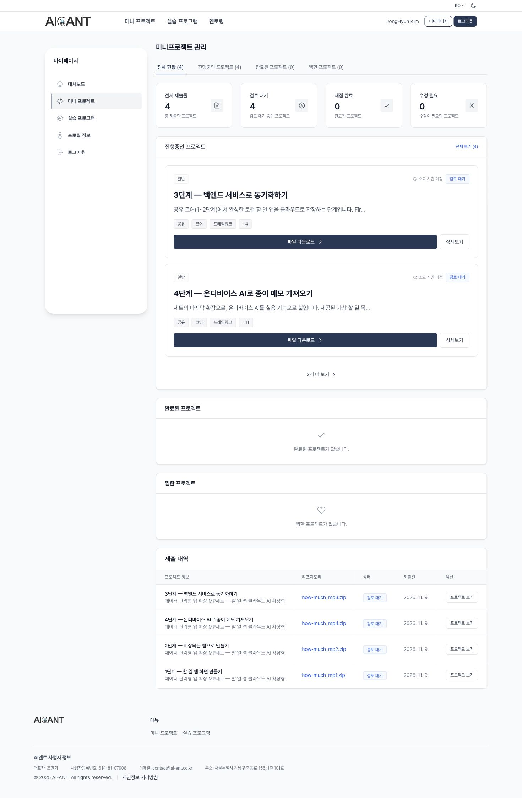

# AI-ANT 제출 보관 — 2026-11-09

데이터 관리형 앱 확장 MP세트의 MP1~MP4를 제출했다. [제출 내역](https://miniproject.ai-ant.ai/mypage/mini-projects)에서 네 건 모두 **검토 대기**로 확인했다. 자체 서버의 대체 인정과 통과 판정은 아직 받지 않았다.

| 단계 | 실제 업로드한 파일 | 설명·화면 |
| --- | --- | --- |
| MP1 | [how-much_mp1.zip](how-much_mp1.zip) | [추가·완료·빈 상태](mp1/README.md) |
| MP2 | [how-much_mp2.zip](how-much_mp2.zip) | [수정·삭제·필터·재시작](mp2/README.md) |
| MP3 | [how-much_mp3.zip](how-much_mp3.zip) | [자체 서버·오프라인 복귀와 제약](mp3/README.md) |
| MP4 | [how-much_mp4.zip](how-much_mp4.zip) | [실제 기기 내 OCR·선택 저장](mp4/README.md) |

## 증거와 재현

- [제출 확인 화면](submissions-confirmed-all-four.jpg): 전체 제출 4건·검토 대기 4건 및 네 단계의 제출 내역.
- [manifest.json](manifest.json): 업로드한 원본 ZIP의 SHA-256·크기·기준 커밋. 제출 후 ZIP을 재생성하지 않았다.
- [검증 요약](verification/final-result.json): SDK·338개 테스트·분석·Android 네이티브 흐름과 미검증 범위.
- 각 `mpN/screenshots/`에 실제 실행 화면을 보관했다. MP2·MP3·MP4에는 재시작·동기화·OCR 결과 JSON도 있다.
- 재현용 소스와 실행 절차는 [단계별 검증 문서](../../../features/ai-ant-submission.md)에 있다.

## MP3의 차이

사용자가 전달한 교수님의 우선 제출 안내에 따라 Firebase/Supabase 대신 기존 FastAPI/PostgreSQL 구현을 제출했다. 한 에뮬레이터에서 저장 영역을 분리한 A/B 클라이언트를 순차 실행해 HTTPS 동기화와 실제 오프라인 복귀를 검증했다. **두 에뮬레이터 동시 실행과 백엔드 관리 콘솔 캡처는 확보하지 못했다.** 이 내용을 제출 README에도 명시했다.

## 보관 원칙

원본 개인 사진, 실제 인증 정보, 빌드·설치 캐시, 과거 내부 보고서는 제외했다. ZIP에는 실제 제출 당시 앱 소스가 포함된다. 별도 단계의 개발 이력을 만든 것이 아니며 기존 앱의 스냅샷을 각 평가 기준에 맞춰 제출했다. MP1·MP2·MP4의 소스는 같고 MP3에는 후속 동기화 통합 시험과 서버 소스를 추가했다.

실습노트의 13:30~14:08(38분)은 최초 MP1·MP2·MP4 준비 구간이다. 이후 MP3 검증 시간을 소급해서 추가하지 않았다.

